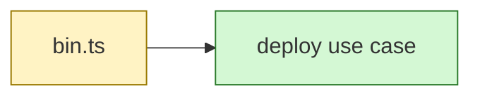

Write one review report for one GitHub pull request. Do not execute the QA scenarios.

The report tells the reviewer what was built and where the important code is, then gives the paths to run by hand before merging. It is read on GitHub in a minute: short sections, a diagram, links that open the right lines, three sharp scenarios.

A scenario is a path a person runs in the product. A failed run shows the feature is wrong.

Print the report in the chat. Post it on GitHub only when the caller asks (see [Posting](#posting)): by default the user decides whether it is shared.

## Input

- A GitHub pull request URL, or a pull request body already read by `/boilerlift:implement-plan-local` together with its URL.
- Optional: a **commit range** `<before>..<after>`. The caller passes it after a fix: every section then covers only that range.
- Optional: a **fix description**, passed with the range after a fix.
- Optional: **caller assumptions**, the readings the caller took while coding.
- Optional: a request to **post as a pull request comment**.

The source of truth is the pull request body. It holds either a decision summary under `## Decisions` (written by `/boilerlift:ship`) or a step plan. Accept both. Read it and the pushed head commit:

```bash
gh pr view <url> --json title,number,body,url,headRefOid
```

No URL: stop and say a GitHub pull request URL is required.

The body has neither a `## Decisions` section nor steps: stop and say there is nothing to test against.

Read the changes:

- No range (the first push, or the skill typed with only a URL): the whole pull request, base..head. Use `gh pr diff <url>`, not `git diff`: the local base may be stale, and the pull request diff is what will merge.
- A range: `git diff <before>..<after>`. Only these commits count, for every section.

The **head SHA** is `<after>` when a range is given, otherwise `headRefOid`. When `/boilerlift:implement-plan-local` called this skill, read after its push, so the diff and the head SHA include the commits just made.

## What was done

At most 5 one-line bullets, in the reader's words: what a person or a caller of the code can now do, or what changed in behaviour. Not a file list. After a fix, only what the fix changed.

## Diagram

A mermaid diagram of the changed parts and how they connect: modules, files, functions, commands, skills, whichever level makes the change readable. Mark each part as new or changed, with a `classDef new` and a `classDef changed` and a legend line under the diagram. Show an unchanged part only when a changed part connects to it and the link explains the change. Keep it under about 12 nodes.

````markdown

New parts in green, changed parts in yellow.
````

No diagram when the diff touches one file and adds no new module, function or file. `## Diagram` is then this one line: `No diagram: the change stays inside one file and adds no new part.`

## Where to look

At most 5 links, each with a one-line reason. Rank them by risk: lines most likely to hide a bug or break a must-not-break rule first (core logic, state changes, error paths), then wiring. When the diff has fewer than 5 meaningful places, list fewer: never pad.

Point each link at the first line of the place, by its line number in the diff: the new file's number for an added or kept line (side `R`), the old file's number for a deleted line (side `L`). Build every URL with the helper, never by hand:

```bash
python3 ${CLAUDE_SKILL_DIR}/scripts/links.py --pr <url> --sha <head SHA> --path <path> --line <n> --side R
```

It prints one URL pinned to the head SHA, so later fixes do not shift it. Exit 2 is one `error:` line: fix the argument and run it again.

Format each entry as a bullet: `- [<path>:<line>](<url>): <reason>`.

## Assumptions

The caller assumptions first, then each item of the body's `### Open assumptions`, one bullet each, without duplicates. When both are empty, the section is `None`.

## QA

Choose and write the scenarios with the rules below. After a fix, only the scenarios the fix touches (see [Only the scenarios affected by a fix](#only-the-scenarios-affected-by-a-fix)).

### Candidates

Write one candidate per distinct outcome the body and the diff both support. With a decision summary, each decision that changes what a person sees or can do is a source of outcomes. Include the success path and a failure a person would actually hit.

Skip a behavior the body does not describe. Skip a behavior the diff does not change. Skip a minor variant that confirms the same result again.

Human-testable means a person can set up the state, perform the steps, and see whether the expected result holds. Reading code, logs, GitHub, or a workflow is not a candidate. Opening the pull request, the branch, the review comment, and the commits are not candidates. Do not add a candidate whose only step is running the verify command.

Setup is product state the person puts in place first, such as a screen, a record, or an account. It is not a fact about the repository.

Copy UI strings from the body verbatim, including punctuation and language.

### Score

Score every candidate. Do not print the scores or the candidates you drop. Each criterion is 0, 1, or 2.

- **Breaks the feature.** 2 if a failed run means the feature does not do what the body promises. 1 if a failed run means one required fact is wrong and the main path can still pass. 0 if the failure is cosmetic or repeats a result already scored.
- **A person hits it.** 2 if normal use of the feature reaches this path. 1 if a person reaches it only when a state the body names is present. 0 if a person cannot reach it in the product.
- **Stands alone.** 2 if its setup and its expected result differ from every higher-scored candidate. 1 if it shares a setup and checks a different result. 0 if it confirms the same result again.

Add the three numbers. Keep the three highest totals. A tie goes to the path a person hits first in normal use. Drop a candidate that scores 0 on **A person hits it**.

Fewer than three candidates remain: write only those. None remain: stop and say there is nothing to test.

### Only the scenarios affected by a fix

When the caller passes a range or a fix description, score as above, then keep only the kept scenarios whose steps or expected result the fix touches: the fix changes a screen, string, state, or rule that the scenario uses or checks. Add a candidate the fix itself introduces if it scores into the top three. The result may be one or two scenarios.

No scenario is touched: the QA section is `No scenario is affected by this fix.`

### Scenario format

Use exactly this format, highest score first, so every pull request gets the same scenarios.

```markdown
### <short English name>
Steps:
1. <setup: put the product in the starting state>
2. <next step the tester does>
3. <next step>

Expected: <one or two lines of observable facts>
```

- Steps are a numbered list. Step 1 is the setup. Each step is one imperative English sentence.
- Expected is one or two lines of observable facts from the body: visible copy, a cleared field, a status, a record present or absent. UI strings verbatim.
- No precondition block. No checkboxes.

## Output

Use exactly this layout and order, so every report reads the same. Start with the title. Nothing else in the header. No pull request title. No URL.

- After the first push, or with only a URL: `# Report`
- After a fix: `# Report — fix: <one line>`, the fix description in one line.

```markdown
# Report

## What was done
- <bullet>

## Diagram
<mermaid block and legend, or the one line saying why none is needed>

## Where to look
- [<path>:<line>](<url>): <reason>

## Assumptions
None

## QA
### <short English name>
Steps:
1. <setup>
2. <step>

Expected: <observable facts>
```

## Posting

Only when the caller asks. Write the report to a temporary file first, so the Markdown is not mangled by the shell, then post it as one new comment:

```bash
gh pr comment <url> --body-file <file>
```

Never edit an earlier report comment.

Post failure: print the full report and the `gh` error line in the chat, then end normally. Do not retry and do not stop the caller: the report in the chat is enough to QA.

Posted: print the report in the chat as well.

## Example

````markdown
# Report — fix: keep the folder when the server is forgotten

## What was done
- Forgetting the server keeps the chosen folder.

## Diagram
No diagram: the change stays inside one file and adds no new part.

## Where to look
- [src/server/forget.ts:18](https://github.com/o/r/pull/9/files/<sha>#diff-<hash>R18): the field list that is cleared, where a missed field leaks old data.

## Assumptions
None

## QA
### Forget the server
Steps:
1. Register a server in the app.
2. Open Server and tap **Forgot server**.
3. Confirm `Forgot server?`.
4. Return to Home.

Expected: the URL, identifier, password and phone name are cleared, the folder is kept. Home shows `No server`.
````
