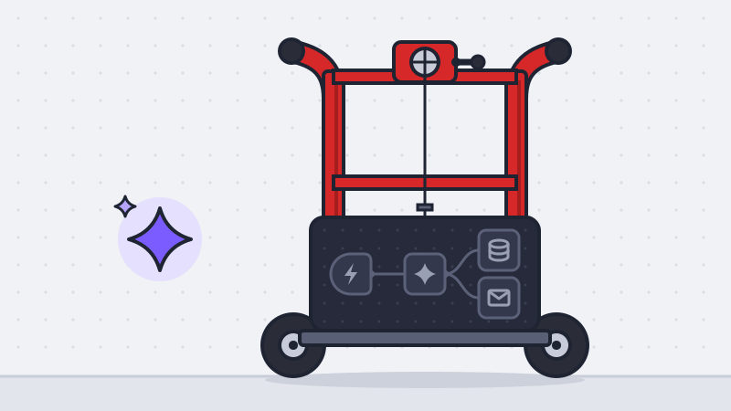

# Build once. Lift everywhere.

**Version, test and deploy your n8n workflows to every environment and client, from one Git repo.**



[](https://www.npmjs.com/package/boilerlift)
[](https://github.com/laurentvandelle/boilerlift/actions/workflows/verify.yml?query=branch%3Amain)
[](https://github.com/laurentvandelle/boilerlift/blob/main/LICENSE)
[](https://nodejs.org)
[](https://docs.n8n.io)

Build a workflow once, keep it in Git, and lift it to dev, staging, prod or every client's n8n instance with one command. Every change is checked before it leaves your machine, and lands as a draft: the live version keeps running until you publish.

> Status: pre-release (0.x). It works, but expect changes between versions.

## Install

```sh
npm install -g boilerlift
```

This installs the `lift` command (`boilerlift` is an alias). Requires Node.js 22.18 or later, and n8n 2.35.0 or later.

## Quick start

1. Install Boilerlift in your project, so workflow files can import it:

   ```sh
   npm install --save-dev boilerlift
   ```

2. Create `boilerlift.config.ts` at the project root, with one target:

   ```ts
   import { defineConfig } from 'boilerlift';

   export default defineConfig({
     targets: {
       dev: { url: process.env.N8N_URL, apiKey: process.env.N8N_API_KEY, workflows: './workflows' },
     },
   });
   ```

3. Set `N8N_URL` and `N8N_API_KEY` in `.env` (keep it out of Git):

   ```sh
   N8N_URL=https://your-n8n.example.com
   N8N_API_KEY=your-api-key
   ```

4. Check the connection:

   ```sh
   lift ping
   ```

5. Add a tiny workflow, `workflows/hello.workflow.ts`:

   ```ts
   import { defineWorkflow } from 'boilerlift';

   export default defineWorkflow({
     name: 'Hello',
     nodes: [{ parameters: {}, name: 'Start', type: 'n8n-nodes-base.manualTrigger', typeVersion: 1, position: [0, 0] }],
     connections: {},
   });
   ```

6. See what a deploy would do, without writing anything:

   ```sh
   lift deploy --dry-run
   ```

   Then run `lift deploy` to deliver it as a draft.

## Docs

- [Write a workflow](https://github.com/laurentvandelle/boilerlift/blob/main/docs/workflows.md)
- [Configure your targets](https://github.com/laurentvandelle/boilerlift/blob/main/docs/configuration.md)
- [`lift ping`](https://github.com/laurentvandelle/boilerlift/blob/main/docs/commands/ping.md): check the connection to your instance
- [`lift deploy`](https://github.com/laurentvandelle/boilerlift/blob/main/docs/commands/deploy.md): deliver your workflows, or preview with `--dry-run`

`lift help` lists every command and `lift help <command>` its options; `lift version` prints the installed version.

## Contributing

See [CONTRIBUTING.md](https://github.com/laurentvandelle/boilerlift/blob/main/CONTRIBUTING.md).

## License

[MIT](https://github.com/laurentvandelle/boilerlift/blob/main/LICENSE)

Boilerlift is an independent open source project. Not affiliated with n8n GmbH.
